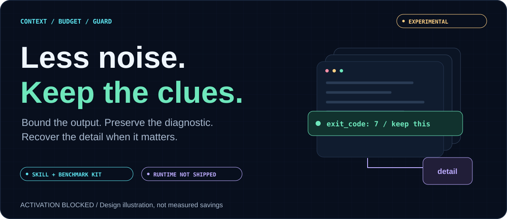

# Context Budget Guard



[](https://github.com/seatrunk/context-budget-guard/actions/workflows/ci.yml)
[](LICENSE)

**[The idea](#the-idea) · [How it should work](#how-it-should-work) · [The plan](#the-plan) · [Evaluation](#how-we-plan-to-evaluate-it) · [Try the toolkit](#try-the-toolkit)**

> **Experimental · activation BLOCKED.** This repository ships an operating skill, specifications and benchmark tools—not runtime enforcement or an installer. The separate local candidate was **REJECTED** by independent review. These graphics explain the intended design; they do not announce a working release or measured savings.

## The idea

An agent can drown in tool output: a compiler dump, a long file, a giant JSON response. The important part may be just one exit code, one source location, or a short runtime notice.

**The goal is not to delete more text. It is to keep the information the next decision needs—and make the rest recoverable.**

| Keep in view | Keep recoverable | Never trade away |
| --- | --- | --- |
| Useful preview, failure status, necessary notices | Additional detail in a private/redacted artifact | Trust boundaries, valid media, mandatory controls, approved read semantics |

The [operating skill](SKILL.md) describes how to review that behavior. The runtime would enforce it. **Loading a skill is not installing a guard.** Conversation-summary compaction is another layer, not a different name for this tool-output policy.

## How it should work


### One output, two destinations

1. **For the model:** a useful bounded preview, original error/exit semantics, valid media and any necessary notice.
2. **For recovery:** additional output in a private/redacted artifact, read with targeted `offset` / `limit` when the task actually needs it.
3. **Across both:** track notice ownership by call ID, reserve its complete rendered footprint before spilling, and never restore an unbounded note after the final cap.

A note sitting in a file is not the same as a note the model received. A small preview is not successful if it hides the reason a command failed.

### The proposed defaults

| Surface | Intended ordinary limit | Important boundary |
| --- | --- | --- |
| Complete file selection | 350 effective LF lines **and** 16,384 formatted UTF-8 bytes | Both limits apply; define empty/trailing-line behavior |
| Partial file selection | 150 effective LF lines **and** 16,384 formatted UTF-8 bytes | Paginate instead of silently presenting an incomplete read as complete |
| Final ordinary tool text | 16,384 UTF-8 bytes | Count the final representation, including framing and escaped metadata |
| Inline notice bundles | Up to 4,096 bytes per bundle; 8,192 per batch | Active policy/tiny-budget decisions still apply; archive or use a bounded marker |

Mandatory controls and valid one-use read receipts retain their defined exceptions. Aggregate turn accounting is separate from per-result bytes; irreducible-overhead reporting must not become a byte-limit escape hatch. None of these proposed limits is a total token, money, filesystem or same-UID security boundary. See the [full design](docs/design.md).

## The plan


**We are between “review rejected” and “repair + re-review,” not between “tests passed” and “ship it.”**

The latest cycle added protected note handling and passed its primary short plugin/LSP aggregate-spill reproduction. Its existing suites passed, but their permanent tests missed the three boundaries below. Fresh adversarial review reproduced:

| Open gap | Why it matters | Track it |
| --- | --- | --- |
| Multimodal output can exceed the byte ceiling in the corrective fallback | Reproduced with deliberately non-progressing aggregate enforcement; see the [F1 probe scope and string control](docs/reviews/2026-11-03-protected-notes.md#f1--corrective-multimodal-compaction-exceeds-the-ceiling-p1) | [#6](https://github.com/seatrunk/context-budget-guard/issues/6) |
| Finalization re-limits an already-approved note-bearing read after its one-use receipt was consumed | Preserve the approved output; do not retain or replay the receipt | [#7](https://github.com/seatrunk/context-budget-guard/issues/7) |
| A literal wrapper delimiter in a queued note remains unsanitized | Test the note's own trust boundary, not just the tool body's | [#8](https://github.com/seatrunk/context-budget-guard/issues/8) |

[#9](https://github.com/seatrunk/context-budget-guard/issues/9) separately tracks the lifetime of delivered control-note ownership. The original correctness issues remain open; these graphics do not close them.

Read the [current status](docs/project-status.md), [cycle report](docs/reviews/2026-11-03-protected-notes.md), or [sanitized evidence JSON](docs/reviews/2026-11-03-protected-notes.json). The native patch and complete probe package are not distributed here, so public CI cannot reproduce or approve that absent runtime.

## How we plan to evaluate it


### Fidelity first. Efficiency second.

- **Same workload, different arms:** freeze the inputs, call order, budgets and runtime fingerprints. Compare an unbudgeted reference, historical spilling and the actual isolated candidate—not a toy replacement.
- **Check what survives:** diagnostic facts, note placement, failure status, media order, receipt lifetime, artifact recovery and no repeated tool execution.
- **Then measure the whole cost:** output bytes, recovery/tool calls, timing, and actual provider/tokenizer usage when available. Count retries and follow-up reads; report unknown costs as unknown.
- **Only later, with separate approval:** real coding tasks and tests, followed by deliberate conversation-compaction interaction experiments. A benchmark cannot authorize production activation.

The [evaluation protocol](docs/multi-codebase-evaluation.md) is published; the replay harness and execution are **not implemented** by that document. [#11](https://github.com/seatrunk/context-budget-guard/issues/11) tracks the actual benchmark work.

The historical [November 2 baseline](benchmarks/results/2026-11-02-off-baseline.json) remains **guard off, one observation per case**. There is no published on-mode comparison, measured savings, or verified live-backend enforcement. The [benchmark guide](docs/benchmarking.md) explains the evidence limits.

## Núcleo e adaptadores (v0.3.0)

Desde a Etapa 1 o repo publica o núcleo puro, sem I/O e sem dependências (Python 3.11+ stdlib):

| Caminho | O que é |
| --- | --- |
| [`cbg/`](cbg/) | `limits` (linhas LF efetivas, corte UTF-8), `render` (bytes finais com framing, escaping JSON multimodal e sufixo de nota), `notes` (ownership por call ID), `sanitize` (delimitadores), `budget` (limitador e lote) e `verify` (verificador independente do recibo) |
| [`adapters/hermes/`](adapters/hermes/README.md) | plugin do Hermes Agent via hook `transform_tool_result`, default `shadow` |
| [`adapters/mcp_proxy/`](adapters/mcp_proxy/README.md) | proxy MCP stdio, default `shadow` |
| [`benchmarks/replay/`](benchmarks/replay/README.md) | replay offline com três braços e oráculos de fidelidade |
| [`docs/model/notes.md`](docs/model/notes.md) | máquina de estados das notas |

Cada resultado sai com um recibo (`rendered_bytes`, `rendered_sha256`, fatos preservados, sha256 do artefato). O verificador relê a saída final e, se o recibo não bate, entrega um marcador limitado (fail closed).

```sh
python3 -m unittest discover -s tests -v
python3 benchmarks/replay/replay.py
```

O patch nativo privado continua fora do repo. Ativação em produção segue bloqueada pelo [rollout](docs/rollout.md).

## Try the toolkit

Python 3.11+, no dependency installation, credentials or live profile required:

```sh
python3 -m unittest discover -s tests -v
python3 scripts/check_repo.py
python3 scripts/validate_benchmark.py benchmarks/results/2026-11-02-off-baseline.json
```

These check the **public tooling**, not the separate runtime. To create synthetic fixtures, choose a new output directory:

```sh
python3 scripts/generate_fixtures.py --output benchmark-fixtures
```

The generator refuses existing paths. Generating fixtures does not run a model, recreate measured timing, or complete the proposed multi-codebase benchmark.

## Go deeper

| Start here | What you get |
| --- | --- |
| [Operating skill](SKILL.md) | Repeatable evidence and review procedure |
| [Design](docs/design.md) | Invariants, exceptions and protected-note contract |
| [Project status](docs/project-status.md) | Exact candidate fingerprint and remaining blockers |
| [Latest cycle](docs/reviews/2026-11-03-protected-notes.md) | What passed, what failed and what we learned |
| [Evaluation protocol](docs/multi-codebase-evaluation.md) | Proposed corpus, comparison arms, metrics and promotion gates |
| [Rollout](docs/rollout.md) | Separate approval and rollback requirements |
| [Governance](docs/repository-governance.md) | Required review and branch protections |
| [Visual guide](docs/visual-guide.html) · [artwork sources](docs/assets/README.md) | Self-contained offline gallery and editable SVG/PNG graphics |

Contributions are welcome, especially small adversarial reproductions. Start with [CONTRIBUTING.md](CONTRIBUTING.md). Keep sensitive reports private under [SECURITY.md](SECURITY.md), follow the [code of conduct](CODE_OF_CONDUCT.md), and preserve the existing [MIT license](LICENSE) attribution.
