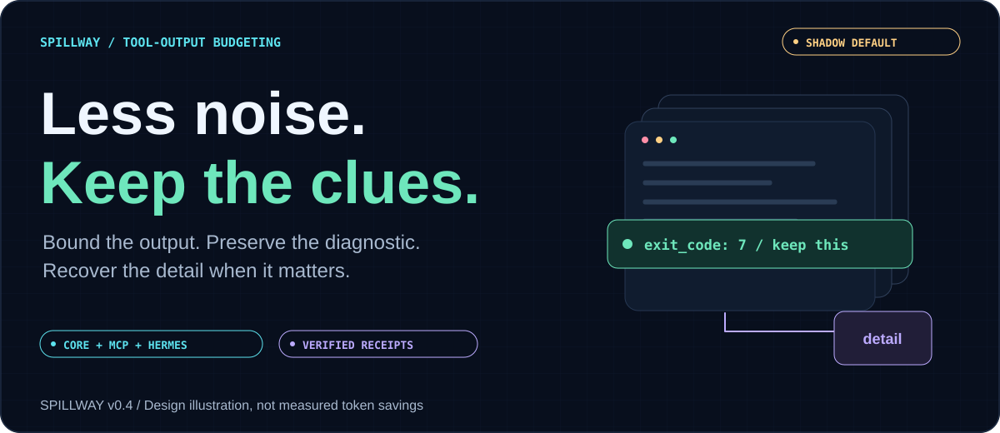
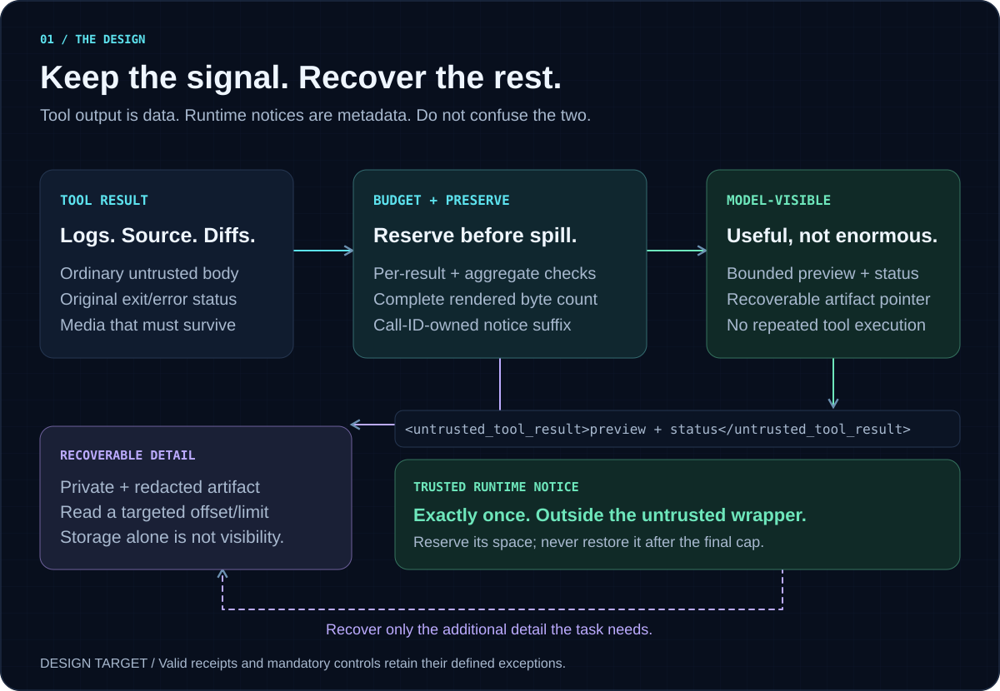
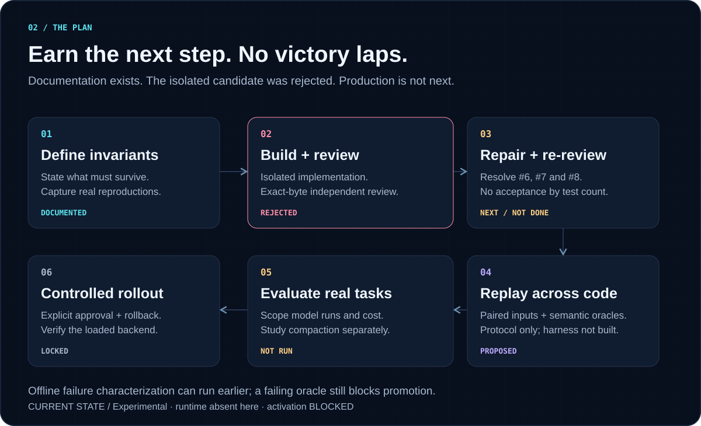

# Spillway



[](https://github.com/seatrunk/context-budget-guard/actions/workflows/ci.yml)
[](LICENSE)


**Spillway caps oversized tool output for LLM agents without losing the clue that matters.** A compiler dump, a 5,000-line log or a giant JSON response is turned into a bounded preview. The exit code, error locations and runtime notes are kept, and the complete original is saved privately so the agent can read it back page by page.

Think of a dam spillway. Normal flow passes untouched. During a surge the crest height is enforced, and the overflow is diverted to a basin instead of breaking things downstream.

> **Status: experimental (v0.4.0).** The core, the MCP proxy and the Hermes plugin work, are tested, and default to **`shadow`**: they measure and log, and the model sees the original output. **`enforce` is not production-approved.** See [rollout gates](docs/rollout.md) and [project status](docs/project-status.md). Previously named *Context Budget Guard* (`cbg`); see [migration](#migrating-from-context-budget-guard).

**[Why](#why) · [What the model sees](#what-the-model-sees) · [Quick start](#quick-start) · [Configuration](#configuration) · [Recovery](#recovering-spilled-output) · [How it works](#how-it-works) · [Evidence](#evidence) · [Security](#security-and-privacy) · [Development](#development)**

---

## Why

Simple truncation helps you hit a size target, but it often cuts the wrong part: the exit code at the end, the `src/lib.rs:12` in the middle, or the plugin note that was attached after the cut. Spillway keeps fidelity first and makes size the second goal:

| Always kept in view | Kept recoverable | Never traded away |
| --- | --- | --- |
| Head and tail preview, `exit_code`, up to 5 `file:line` locations (or short `ERROR`/`panic` clues), call-owned notes | Full unredacted original in `artifacts/<sha256>.txt` (0600), read by offset/limit | One genuine `<untrusted_tool_result>` wrapper, media order, mandatory control content, approved-read receipts |

It is **not** conversation summarization, a token or cost cap, or a sandbox. It bounds individual tool results and tool-result batches.

## What the model sees

A 29,490-byte `cargo build` failure capped at 640 bytes (the default cap is 16,384):

```text
<untrusted_tool_result>
[spillway preview] original 29490 bytes, 1104 lines; exit_code=101; errors: src/lib.rs:12; artifact sha256=8813b5fa…3101 (read with offset/limit)
   Compiling crate000 v0.1.0
   Compiling crate001 v0.1.0
   …
[...]
note: detail 198
note: detail 199
error: could not compile `demo`
exit code: 101
</untrusted_tool_result>
```

(The real header carries the full 64-character SHA-256; it is shortened here.)

- The **header** is built from the full output, so the facts survive whatever is cut.
- The **head and tail** are cut on UTF-8 and line boundaries. Line-limited reads get only a head, and it gets the whole byte budget.
- Text inside the result that imitates `[spillway …]`, `[note:…]` or the wrapper tags is neutralized, so tool output cannot forge a header.
- Results that fit pass through unchanged (`mode: full`).

## Quick start

Requires Python 3.11+ and nothing else.

```sh
git clone https://github.com/seatrunk/context-budget-guard spillway && cd spillway
pip install .            # or: pipx install .   — provides the `spillway` command
spillway --version
```

Or install straight from Git: `pipx install git+https://github.com/seatrunk/context-budget-guard`. Spillway is not published on PyPI.

### 1. Wrap any MCP server

Put `spillway mcp` in front of the server command in your MCP client configuration:

```json
{
  "mcpServers": {
    "filesystem": {
      "command": "spillway",
      "args": ["mcp", "--mode", "shadow", "--", "npx", "-y", "@modelcontextprotocol/server-filesystem", "."]
    }
  }
}
```

- **`shadow`** (the default): every response passes through byte for byte. One content-free receipt per `tools/call` is appended to `~/.cache/spillway/receipts.jsonl`.
- **`enforce`**: oversized `tools/call` results become previews. `isError` and media are kept, and `structuredContent` is dropped from cut responses because it would bypass the cap. The original is saved under `artifacts/`, and a `spillway_read_artifact` tool is added to `tools/list` for recovery.
- **`off`**: plain passthrough. No files are written.

Without installing: `python3 adapters/mcp_proxy/proxy.py [options] -- <server command>`.

### 2. Hermes Agent plugin

```sh
sh adapters/hermes/install.sh      # copies the plugin and core to ${HERMES_HOME:-~/.hermes}/plugins/spillway
hermes plugins enable spillway     # then restart Hermes (plugins are discovered once per process)
```

The plugin uses Hermes's public `transform_tool_result` hook and does not modify Hermes. It is `shadow` by default; set `SPILLWAY_MODE=enforce` in the Hermes environment to cut output. To turn it off, run `hermes plugins disable spillway` or set `SPILLWAY_MODE=off`. Details: [adapters/hermes/README.md](adapters/hermes/README.md).

### 3. Library

```python
import spillway

out = spillway.apply_budget("call-1", huge_text, exit_code=2)
out.mode                       # "full" | "preview" | "marker" | "withheld" | "failclosed" | "control"
out.rendered.model_text()      # exactly what the model would see (≤ cap bytes)
out.receipt                    # content-free, verified receipt (sizes, hashes, facts)
out.artifact                   # full original when cut (persist it yourself, e.g. ArtifactStore)

# A batch with a turn budget: small rows keep their size, big rows shrink first.
outs = spillway.finalize_batch(
    [{"call_id": "a", "result": log_a}, {"call_id": "b", "result": log_b}],
    turn_budget=24_000,
)
```

The budgeting core (`limits`, `render`, `notes`, `sanitize`, `facts`, `budget`, `verify`) does no I/O. All filesystem access lives in [`spillway/artifacts.py`](spillway/artifacts.py).

## Configuration

| Environment variable | CLI flag (`spillway mcp`) | Default | Meaning |
| --- | --- | --- | --- |
| `SPILLWAY_MODE` | `--mode` | `shadow` | `off`, `shadow` or `enforce`. An invalid value falls back to `shadow` (Hermes) |
| `SPILLWAY_LOG_DIR` | `--log-dir` | `~/.cache/spillway` (MCP), `$HERMES_HOME/spillway` (Hermes) | Holds `receipts.jsonl`, `errors.jsonl` and `artifacts/` |
| `SPILLWAY_RESULT_CAP` | `--cap` | `16384` | Per-result cap in UTF-8 bytes; the floor is 256 |
| `SPILLWAY_FRAMING_RESERVE` | — | `512` | Hermes only: bytes left for the wrapper Hermes adds afterwards |
| `SPILLWAY_WRAP_UNTRUSTED` | `--wrap-untrusted` | off | MCP only: keep the `<untrusted_tool_result>` wrapper in the enforced text |
| `SPILLWAY_MAX_ARTIFACTS` | `--max-artifacts` | `200` | Retention: maximum number of artifact files (oldest are evicted first) |
| `SPILLWAY_MAX_ARTIFACT_BYTES` | `--max-artifact-bytes` | `104857600` | Retention: maximum total artifact bytes |

The legacy `CBG_MODE`, `CBG_LOG_DIR`, `CBG_RESULT_CAP`, `CBG_FRAMING_RESERVE` are still read when the matching `SPILLWAY_*` variable is unset or empty.

Core defaults (`spillway.Policy`): 16,384 bytes per result; 350 lines for full file reads and 150 for partial reads; notes up to 4,096 bytes each and 8,192 bytes per batch; a floor of 1,024 bytes per row during batch settlement.

## Recovering spilled output

- **MCP clients:** in `enforce` mode, call the added tool `spillway_read_artifact` with `{"sha256": "<64 hex>", "offset": 0, "limit": 8192}`. Each slice is UTF-8 safe, reports `next_offset` and `eof`, and is neutralized like any other tool output. Slices are requested at up to half the cap and shrunk further if needed, so the response always fits.
- **Hermes:** the header gives the absolute path, e.g. `artifact path=~/.hermes/spillway/artifacts/<sha256>.txt`. Read it with the agent's normal `read_file` offset/limit.
- **Housekeeping:** `spillway prune --log-dir DIR [--max-artifacts N] [--max-bytes B]` applies the retention limits. Writes also prune automatically.

## Receipts and `spillway stats`

Each tool result writes one JSON line to `receipts.jsonl`. It contains no output content: sizes, SHA-256 hashes, mode, exit code, error locations, note IDs, `verified`, `would_change` and `elapsed_us`.

```sh
spillway stats                       # default: $SPILLWAY_LOG_DIR/receipts.jsonl or ~/.cache/spillway/receipts.jsonl
spillway stats ~/.hermes/spillway/receipts.jsonl --json
```

```text
results: 412  would_change: 37  not_verified: 0
bytes:   before=3120044  after=1048213  modes={'full': 375, 'preview': 37}
latency: n=412  p50=180us  p95=950us  max=4100us
```

(Illustrative output. Run `shadow` for a while and read your own numbers before you consider `enforce`.)

The field reference is in [docs/design.md](docs/design.md#receipt-fields).

## How it works



1. **Render and measure exactly.** The final model-visible representation is what gets measured: framing, multimodal JSON escaping and note suffixes included. Measurement is never an estimate.
2. **Extract facts from the full output.** The exit code, `file:line` locations (Python, TypeScript/MSBuild, GCC, Rust, ESLint, SQL, Make and others, including inside JSON-escaped strings) and fallback error clues.
3. **Cut per result.** If the rendered result exceeds the cap or its line limit, Spillway builds a header, a head and a tail on UTF-8 and line boundaries, then re-measures until it fits. If no preview fits, it uses a header-only marker.
4. **Settle the batch.** If a turn budget is exceeded, control rows and approved-read receipts stay fixed. The rest are water-filled: small rows keep their size and the largest rows shrink first. A policy failure withholds bodies but keeps the notes each call owns. Tools are never re-run.
5. **Verify independently.** [`verify.py`](spillway/verify.py) does not import the budgeting code. It re-parses the final output and checks the byte cap, receipt hash, a single genuine wrapper, the exit code, the locations, and that each note appears exactly once outside the wrapper. Any mismatch replaces the output with a bounded fail-closed marker.
6. **Track note ownership.** Plugin and LSP notes belong to a call ID and move through `PENDING → DELIVERED → RETIRED`, with bounded state. See [docs/model/notes.md](docs/model/notes.md); 10,000 random sequences are property-tested.

The full design and its invariants are in [docs/design.md](docs/design.md).

## Evidence

Offline replay: 12 synthetic cases, 0 model calls and no network. Each arm is scored by ground-truth oracles that are independent of Spillway's verifier. It is reproducible byte for byte and runs in CI.

| Arm | Model-visible bytes | Oracles passed | Typical failures |
| --- | ---: | ---: | --- |
| `none` (no budget) | 297,924 | 46 / 62 | over the cap, aggregate over budget, forged/duplicate wrapper |
| `historical` (emulated character-based spill) | 163,871 | 43 / 62 | lost exit codes and locations, dropped notes |
| `candidate` (Spillway) | 146,175 | **62 / 62** | — |

```sh
python3 benchmarks/replay/replay.py --out /tmp/offline-replay.json
cmp /tmp/offline-replay.json benchmarks/replay/results/offline-replay.json && echo identical
```

**What this does not show:** token or cost savings on real tasks, or task success rates. The `historical` arm is an emulation, not the old runtime. A real-task A/B benchmark (shadow first, then paired enforce runs) is the next gate; see [docs/benchmarking.md](docs/benchmarking.md).

## Security and privacy

> In `enforce` mode, `artifacts/<sha256>.txt` holds the **complete, unredacted** output of every cut result. That can include secrets read by the agent (`.env` files, tokens), PII and private code. Spillway redacts nothing.

- Directories are created 0700 and files 0600. Writes and reads use `O_NOFOLLOW`; symlinks and non-regular files are refused, and artifact names must be valid SHA-256 hex. None of this protects against other processes running as the same UID.
- Retention is bounded (200 files / 100 MiB by default). Never point `SPILLWAY_LOG_DIR` inside a repository, and never commit or share `artifacts/` or `*.jsonl`.
- In `shadow` no artifacts are written. Receipts contain no output content, but they do contain tool names and `file:line` locations.
- Both adapters **fail open** on internal errors: the original result goes through, and Hermes logs the exception type name to `errors.jsonl`. The verifier **fails closed** on a receipt mismatch.
- `install.sh` refuses any destination that does not end in `/plugins/spillway` before it runs `rm -rf`.

Report vulnerabilities privately: [SECURITY.md](SECURITY.md).

## Project layout

| Path | Contents |
| --- | --- |
| [`spillway/`](spillway/__init__.py) | Pure core (`limits`, `render`, `notes`, `sanitize`, `facts`, `budget`, `verify`), plus `artifacts` (I/O), `mcp_proxy` and `cli` |
| [`adapters/hermes/`](adapters/hermes/README.md) | Hermes plugin (`spillway/__init__.py`, `plugin.yaml`) and `install.sh` |
| [`adapters/mcp_proxy/`](adapters/mcp_proxy/README.md) | Source-checkout shim for `spillway mcp` |
| [`benchmarks/replay/`](benchmarks/replay/README.md) | Offline three-arm replay, fixtures and committed results |
| [`tests/`](tests/) | Unit, invariant, property, adapter and CLI tests (stdlib `unittest`) |
| [`docs/`](docs/design.md) | Design, note model, benchmarking, rollout, status and historical reviews |

## Development

```sh
python3 -m unittest discover -s tests -v       # 77 tests, about 10 s, includes 10,000 property sequences
python3 scripts/check_repo.py                  # required files, local links, action pins, version consistency
python3 benchmarks/replay/replay.py            # exits 1 if the candidate fails any oracle
python3 benchmarks/replay/gen_fixtures.py      # regenerate replay fixtures (deterministic)
```

Standard library only, with no dev dependencies. CI runs all of the above, plus the test suite and a wheel-install smoke test on Python 3.11, 3.12 and 3.13, and also gitleaks and zizmor. Read [CONTRIBUTING.md](CONTRIBUTING.md) before opening a PR. Model-visible contract changes need a regression test and a [CHANGELOG](CHANGELOG.md) entry.

## Roadmap and status



- **Done:** the pure core, both adapters, offline replay, artifact recovery and packaging (v0.3.0 to v0.4.0).
- **Next:** the real-task benchmark. Run in shadow, then paired A/B enforce runs comparing task success, tokens and cost, recovery reads and fidelity regressions. Protocol: [docs/multi-codebase-evaluation.md](docs/multi-codebase-evaluation.md).
- **Separate track:** a private native Hermes patch whose combined acceptance gate is still **blocked**. Its history is kept in [docs/project-status.md](docs/project-status.md) and [docs/reviews/](docs/reviews/2026-11-04-combined-assessment.md), and none of it is shipped here.
- **Production `enforce`:** gated by [docs/rollout.md](docs/rollout.md).

The [operating skill](SKILL.md) describes how to review output-budget evidence. The [visual guide](docs/visual-guide.html) collects the diagrams.

## Migrating from Context Budget Guard

| Before (0.3.x) | Now (0.4.0) |
| --- | --- |
| `import cbg` | `import spillway` |
| `[cbg preview] original N bytes, M linhas; …` | `[spillway preview] original N bytes, M lines; …` |
| `CBG_MODE`, `CBG_LOG_DIR`, … | `SPILLWAY_MODE`, `SPILLWAY_LOG_DIR`, … (`CBG_*` still read as fallback) |
| `~/.hermes/plugins/context-budget-guard` | `~/.hermes/plugins/spillway` |
| `python3 adapters/mcp_proxy/proxy.py …` | `spillway mcp …` (the old path still works from a checkout) |

The full list is in the [CHANGELOG](CHANGELOG.md#040--2026-11-18). The GitHub repository URL is unchanged for now.

## License

[MIT](LICENSE) © Ricardo Margalho. Contributions are welcome, especially small adversarial reproductions. Follow the [code of conduct](CODE_OF_CONDUCT.md).
